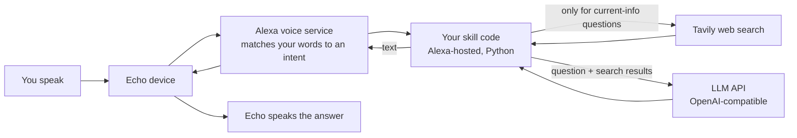

# Alexa AI Assistant

Talk to a modern AI model through your **Amazon Echo**, with **web search**, for **free**.

```
You: "Alexa, open smart helper"
Echo: "Hi! It's good to hear from you. Ask me anything."
You: "who is the current president of the United States"
Echo: "Donald Trump is the 47th and current president, sworn in on January 20, 2025..."
You: "my plant has yellow leaves"
Echo: "That's often too much water or too little light. Let the soil dry out a bit..."
```

This repository is a **step-by-step guide plus a ready-to-use Alexa skill**. You don't need a
server, an AWS account or a credit card. Everything runs on free tiers.

> **Heads-up:** free tiers, model catalogs and console screens change. Everything here was
> tested in **November 2026**. The guide shows you *how to check* each piece (for example,
> which models are fast enough), so you can adapt when things move.

## What you get

- **Any OpenAI-compatible LLM** (NVIDIA, Gemini, OpenRouter, DeepSeek...). You switch providers
  in a config file, with no code changes.
- **Natural conversation:** speak freely, follow up without saying "Alexa", and the skill
  remembers the conversation while it's open.
- **Free web search** ([Tavily](https://tavily.com), 1,000 searches/month). It searches only when
  a question needs current information.
- **Built for the ~8-second limit:** fast model choice, a strict time budget, and a spoken error
  instead of Alexa's generic failure.
- **Voice-safe output:** strips markdown, emojis and characters that would break Alexa's speech.
- **Optional persona:** give the assistant a name and it stays in character.
- **Helper scripts:** pick a fast model, test from the terminal, plus offline tests.

## How it works



You can't replace Alexa's built-in brain. Instead you build a **custom skill**: you open it
by name ("Alexa, open smart helper") and everything you say goes to your code until you say
"stop".

## The guide

| Step | What you'll do | Time |
|---|---|---|
| [1. Accounts and keys](docs/01-accounts-and-keys.md) | Amazon developer account, free LLM key, free Tavily key | 15 min |
| [2. Choose a fast model](docs/02-choose-a-fast-model.md) | Benchmark models against Alexa's 8-second limit | 10 min |
| [3. Create the skill](docs/03-create-the-skill.md) | Set up the skill and its interaction model in the Alexa Developer Console | 10 min |
| [4. Add the code](docs/04-add-the-code.md) | Paste the code and your config, then deploy (console only) | 10 min |
| [5. Use the ASK CLI (optional)](docs/05-ask-cli.md) | Deploy and test from your terminal instead of clicking | 20 min |
| [6. Test on your Echo](docs/06-test-on-your-echo.md) | Simulator, then the real device | 10 min |
| [7. Web search](docs/07-web-search.md) | How search is triggered, tuned, and where it falls short | read |
| [8. Customize](docs/08-customize.md) | Persona, language, invocation name, provider, timeouts | read |
| [9. Troubleshooting](docs/09-troubleshooting.md) | Every error we hit and how to fix it | reference |

## Repository layout

```
lambda/
  lambda_function.py        the skill (handlers, LLM call, search, voice-safe output)
  requirements.txt          ask-sdk-core, openai
  config.example.py         copy to config.py and add your keys (never commit config.py)
skill-package/
  interactionModels/custom/en-US.json   what users can say (intents and slots)
  skill.json                manifest, for reference / ASK CLI
scripts/
  build_interaction_model.py  regenerates and validates en-US.json
  benchmark_models.py         times models to find one fast enough for Alexa
  simulate.py                 talks to your live skill via Amazon's simulator
tests/
  test_offline.py           runs with no keys and no network
ask-resources.json          ASK CLI project file
```

## Quick check without any account

```bash
pip install -r lambda/requirements.txt
python -m unittest discover -s tests -v
```

## Credits and license

MIT licensed (see [LICENSE](LICENSE)). The idea and original structure came from community
projects that connected ChatGPT and DeepSeek to Alexa, such as
[alexandremendoncaalvaro/skill-alexa-chatgpt4](https://github.com/alexandremendoncaalvaro/skill-alexa-chatgpt4)
and [mrtrycatch/deepseek-skill-alexa](https://github.com/mrtrycatch/deepseek-skill-alexa).

This project is not affiliated with or endorsed by Amazon, NVIDIA or Tavily. "Alexa" and "Echo"
are trademarks of Amazon.com, Inc. This is a **personal, development-stage skill**: publishing a
skill to the Alexa store requires Amazon certification. A store-published skill can't present
itself as Alexa, and it needs account linking if each user should bring their own key.
